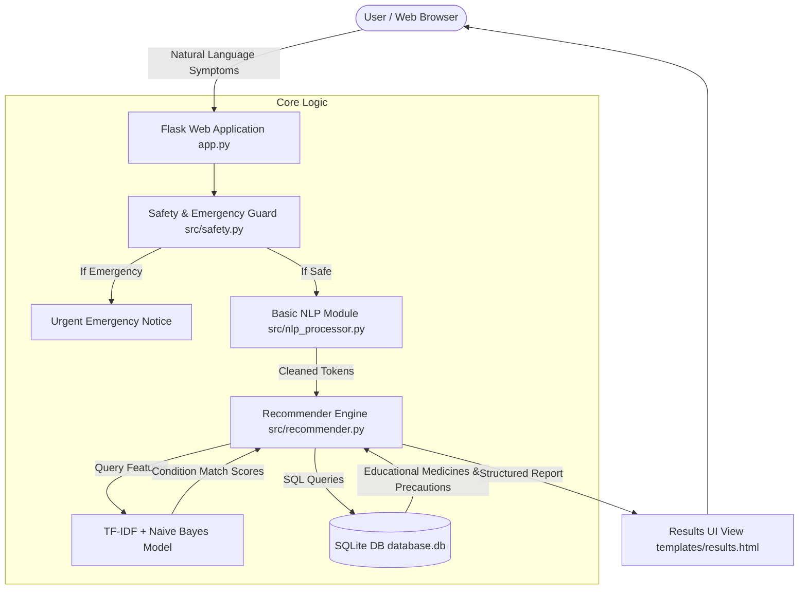

# System Architecture Documentation

## Overview

The **Drug Recommendation System Based on Symptoms** is a web-based educational application built with Python Flask, Scikit-learn, NLTK-style NLP utilities, and SQLite.

## System Architecture Diagram

## Modular Components

1. **Presentation Layer (`templates/`, `static/`)**: Jinja2 HTML templates styled with vanilla CSS following a modern healthcare design system.
2. **Web Service Layer (`app.py`, `config.py`)**: Flask routes handling web navigation, symptom submission, medicine lookup, and feedback.
3. **Safety Layer (`src/safety.py`)**: Screen for high-risk red-flag symptoms and append non-diagnostic educational disclaimers.
4. **NLP Processing Layer (`src/nlp_processor.py`)**: Lowercasing, tokenization, stopword filtering, and synonym normalization.
5. **Machine Learning Layer (`src/recommender.py`, `scripts/train_model.py`)**: TF-IDF feature extraction, Naive Bayes prediction, and overlap similarity scoring.
6. **Data Storage Layer (`src/database.py`, `database.db`)**: Normalized SQLite relational database storing symptoms, conditions, medicines, precautions, and feedback.
