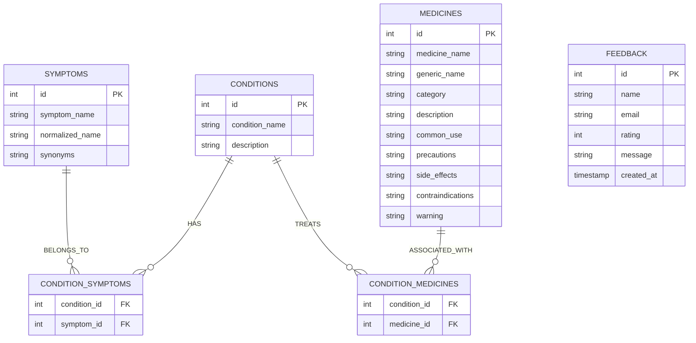

# Database Schema Documentation

## Overview

The database is built on **SQLite3** (`database.db`) using normalized 3NF table design to avoid data redundancy and maintain relational integrity.

## Entity Relationship Diagram

## Table Specifications

### 1. `symptoms`
- `id` (INTEGER PRIMARY KEY)
- `symptom_name` (TEXT UNIQUE)
- `normalized_name` (TEXT)
- `synonyms` (TEXT)

### 2. `conditions`
- `id` (INTEGER PRIMARY KEY)
- `condition_name` (TEXT UNIQUE)
- `description` (TEXT)

### 3. `condition_symptoms`
- `condition_id` (INTEGER, FK -> conditions.id)
- `symptom_id` (INTEGER, FK -> symptoms.id)

### 4. `medicines`
- `id` (INTEGER PRIMARY KEY)
- `medicine_name` (TEXT)
- `generic_name` (TEXT)
- `category` (TEXT)
- `common_use` (TEXT)
- `precautions` (TEXT)
- `side_effects` (TEXT)
- `contraindications` (TEXT)
- `warning` (TEXT)

### 5. `condition_medicines`
- `condition_id` (INTEGER, FK -> conditions.id)
- `medicine_id` (INTEGER, FK -> medicines.id)

### 6. `feedback`
- `id` (INTEGER PRIMARY KEY)
- `name` (TEXT)
- `email` (TEXT)
- `rating` (INTEGER)
- `message` (TEXT)
- `created_at` (TIMESTAMP)
